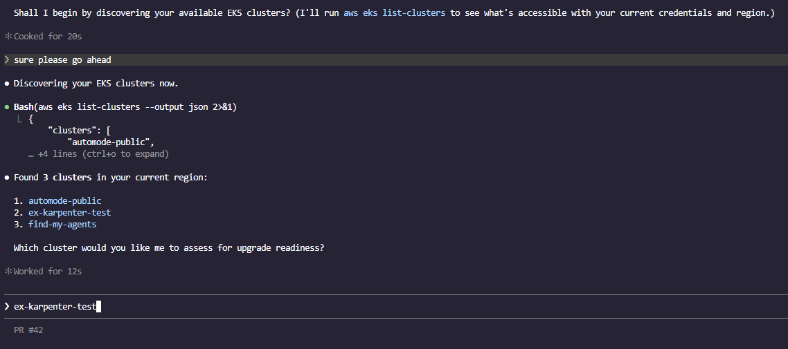
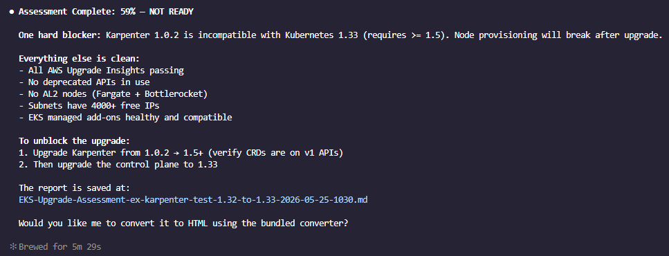
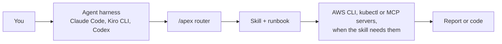

<div align="center">


# APEX Skills

**Platform engineering with agents: curated AWS skills for Amazon EKS and Amazon ECS, delivered through your AI coding agent.**

[](https://aws-samples.github.io/sample-apex-skills/)
[](https://www.npmjs.com/package/apex-skills)
[](LICENSE)
[](https://github.com/aws-samples/sample-apex-skills/actions/workflows/docs-sync.yml)

[Docs](https://aws-samples.github.io/sample-apex-skills/) · [Find a skill](https://aws-samples.github.io/sample-apex-skills/skills/) · [Getting started](https://aws-samples.github.io/sample-apex-skills/docs/getting-started/) · [Contributing](CONTRIBUTING.md)

</div>

## What APEX is

- **Skills**: what your agent knows. 28 skills, written to the [Agent Skills standard](https://agentskills.io/), that design, build, review, upgrade and secure Amazon EKS and Amazon ECS estates.
- **The `/apex` router** (installed from `main`, below): one entry point. Type `/apex` with your request and it picks the right skill and, when there is one, that skill's runbook.
- **DevOps Agent ports**: 6 Day 2 skills repackaged for [AWS DevOps Agent](https://docs.aws.amazon.com/devopsagent/latest/userguide/).

Domain knowledge by AWS Solutions Architects, TAMs and ProServe. 5 skills are vendored from upstream projects; see [Provenance](#provenance).

## Quick start

You need [Node.js 18+](https://nodejs.org/) and [git](https://git-scm.com/), on macOS or Linux (on Windows, use WSL).

```bash
npx apex-skills@1.3.0
```

The installer detects Claude Code and Kiro CLI, clones the repo to `~/.apex-skills/` and links the skills into place. It installs the latest published release of the skills. The skill list below describes `main`. The latest published release does not have the `/apex` router yet, has older versions of some skills and still has steering-workflow-creator, which `main` drops, so install from `main` (below) to get everything listed here.

Ask your agent in plain words and the matching skill loads:

> Is my EKS cluster ready to upgrade to 1.32?

In Claude Code this install also adds `/apex:*` commands, such as `/apex:eks-upgrade-check`; Kiro CLI gets the workflows, without the `eks` hub, as manual steering files in `~/.kiro/steering/`.

Flags, updates and uninstall: [installer README](misc/installer/README.md).

### The `/apex` router

To use the router in Claude Code or Kiro CLI, install from `main` (this also moves an existing install to `main`, which has no `/apex:*` commands or Kiro steering files):

```bash
npx apex-skills@1.3.0 --branch main
```

Then type your request after the router:

> /apex is my cluster ready to upgrade to 1.32?

For Codex, which the installer does not set up, copy the skills by hand:

```bash
git clone https://github.com/aws-samples/sample-apex-skills.git
mkdir -p ~/.agents/skills && cp -r sample-apex-skills/skills/* ~/.agents/skills/
```

In Codex the router is `$apex`. `/apex` in Kiro CLI was tested on 2.35.1 (2026-10-28); 1.27.0 rejected it. Other harnesses, and the optional agent guardrails in [rules/AGENTS.md](rules/AGENTS.md): [Getting started](https://aws-samples.github.io/sample-apex-skills/docs/getting-started/).

## See it work

The [EKS Upgrade Readiness Check](examples/eks-upgrades/in-place-karpenter-check/) example, run in Claude Code:

| The agent finds your clusters | The scored result |
|---|---|
|  |  |

## How it fits



## Pick a skill by what you are doing

Not sure? Use [`/apex`](https://aws-samples.github.io/sample-apex-skills/docs/skills/general/apex/) (installed from `main`) and it picks for you.

<!-- SKILLS_REFERENCE_START -->
> _This list is auto-generated by [`misc/update-skills-references.sh`](misc/update-skills-references.sh) from the SKILL_META table in [`misc/update-pages.sh`](misc/update-pages.sh). Do not edit manually._

### Knowledge Skills

Guidance your agent draws on when you ask and decide.

| Skill | What it does |
|---|---|
| [ecs-genai](https://aws-samples.github.io/sample-apex-skills/docs/skills/ecs/ecs-genai/) | GPU, ML and GenAI workloads on ECS: GPU instances, Inferentia, Trainium and Neuron, launch type choice, training and model inference |
| [eks-best-practices](https://aws-samples.github.io/sample-apex-skills/docs/skills/eks/eks-best-practices/) | EKS architecture advice: compute, networking, security, reliability, cost, scaling, observability, multi-tenancy, upgrades, hybrid and surge readiness |
| [eks-genai](https://aws-samples.github.io/sample-apex-skills/docs/skills/eks/eks-genai/) | GenAI and LLM workloads on EKS: GPU vs Trainium/Inferentia, vLLM and Ray serving, distributed training, ML storage and AI gateways |
| [eks-platform-engineering](https://aws-samples.github.io/sample-apex-skills/docs/skills/eks/eks-platform-engineering/) | Internal Developer Platform design on EKS: Backstage, ArgoCD, Kargo, progressive delivery, golden paths and DORA metrics |

### Day 0 Design

Choose an architecture before you build.

| Skill | What it does |
|---|---|
| [ecs-architect](https://aws-samples.github.io/sample-apex-skills/docs/skills/ecs/ecs-architect/) | Choose the ECS deployment model for a new workload: Fargate, EC2, Managed Instances, Express Mode or ECS Anywhere, capacity providers and task sizing |
| [ecs-observability](https://aws-samples.github.io/sample-apex-skills/docs/skills/ecs/ecs-observability/) | ECS observability architecture: logs, metrics and traces with CloudWatch, Container Insights, X-Ray, ADOT, Managed Prometheus and Grafana, or FireLens |
| [eks-design](https://aws-samples.github.io/sample-apex-skills/docs/skills/eks/eks-design/) | Generate EKS architecture design documents with Mermaid diagrams, ADRs, security architecture and validation reports, guided by Well-Architected practices |

### Day 1 Build

Generate the infrastructure code and the release path.

| Skill | What it does |
|---|---|
| [dotnet-aws-ecs](https://aws-samples.github.io/sample-apex-skills/docs/skills/general/dotnet-aws-ecs/) | Deploy a .NET workload to Amazon ECS Fargate behind an Application Load Balancer, with CloudFormation or CDK and a deployment guide |
| [ecs-build](https://aws-samples.github.io/sample-apex-skills/docs/skills/ecs/ecs-build/) | Generate apply-ready Terraform for ECS clusters, services and task definitions on Fargate, EC2 Auto Scaling or Managed Instances |
| [ecs-devops](https://aws-samples.github.io/sample-apex-skills/docs/skills/ecs/ecs-devops/) | Deploy and release to ECS: blue/green and canary deployments, CI/CD pipelines and rollbacks |
| [eks-build](https://aws-samples.github.io/sample-apex-skills/docs/skills/eks/eks-build/) | Generate production-ready EKS Terraform projects with optional ArgoCD GitOps, air-gapped support and 29+ addon configurations |
| [terraform-skill](https://aws-samples.github.io/sample-apex-skills/docs/skills/general/terraform-skill/) | Terraform and OpenTofu: modules, native tests, Terratest, CI/CD pipelines, state debugging and security scanning |

### Day 2 Operate: assess what is running

Discover, score and review a live cluster or estate.

| Skill | What it does |
|---|---|
| [ecs-operation-review](https://aws-samples.github.io/sample-apex-skills/docs/skills/ecs/ecs-operation-review/) | Structured ECS operational excellence assessment of a live estate across 8 domains with GREEN/AMBER/RED ratings |
| [ecs-recon](https://aws-samples.github.io/sample-apex-skills/docs/skills/ecs/ecs-recon/) | ECS environment discovery: compute and capacity providers, task definitions, deployments, scaling, networking, security, observability and IaC/CI-CD |
| [eks-cost-intelligence](https://aws-samples.github.io/sample-apex-skills/docs/skills/eks/eks-cost-intelligence/) | Live EKS cost efficiency assessment across 6 dimensions with a 0-100 Cost Score and dollar-quantified findings |
| [eks-operation-review](https://aws-samples.github.io/sample-apex-skills/docs/skills/eks/eks-operation-review/) | Structured EKS operational excellence assessment across 10 areas, GREEN/AMBER/RED rated, including deprecated-API review with no target version |
| [eks-recon](https://aws-samples.github.io/sample-apex-skills/docs/skills/eks/eks-recon/) | EKS cluster discovery: compute, networking, security facts, add-ons, workloads, storage, IaC and CI/CD, reported as facts with no scoring |
| [eks-well-architected-review](https://aws-samples.github.io/sample-apex-skills/docs/skills/eks/eks-well-architected-review/) | Unofficial Well-Architected style review of a live EKS cluster (Linux nodes only), scored across five pillars; run only on an explicit WAFR request |

### Day 2 Operate: upgrade and migrate

Move a version, a controller, a CPU architecture or an app.

| Skill | What it does |
|---|---|
| [ecs-modernize](https://aws-samples.github.io/sample-apex-skills/docs/skills/ecs/ecs-modernize/) | Assess an existing VMware or EC2 app from its source code, decide replatform or rearchitect, and migrate it onto ECS |
| [eks-ingress-migration](https://aws-samples.github.io/sample-apex-skills/docs/skills/eks/eks-ingress-migration/) | Assess a live cluster's NGINX/Ingress estate and plan migration to Gateway API, the AWS Load Balancer Controller or AWS Transform |
| [eks-upgrade-check](https://aws-samples.github.io/sample-apex-skills/docs/skills/eks/eks-upgrade-check/) | Assess EKS cluster upgrade readiness with a 0-100 score across 8 areas including deprecated APIs, add-on compatibility and workload risks |
| [graviton-migration](https://aws-samples.github.io/sample-apex-skills/docs/skills/general/graviton-migration/) | Migrate a workload from x86 to AWS Graviton (arm64): arm64 readiness scanning with the Arm migration MCP server, then the Karpenter node cutover on EKS |

### Day 2 Operate: secure

Check exposure, harden and prepare for audits.

| Skill | What it does |
|---|---|
| [ecs-security](https://aws-samples.github.io/sample-apex-skills/docs/skills/ecs/ecs-security/) | ECS security and compliance: task and execution roles, iam:PassRole, trust policies, secrets injection and shared responsibility on Fargate and EC2 |
| [eks-security](https://aws-samples.github.io/sample-apex-skills/docs/skills/eks/eks-security/) | Read-only scripted security reviews of a live EKS cluster (CVE exposure, security event response, posture check) plus hardening: CIS, HIPAA, PCI-DSS, FedRAMP |

### Set up and extend

Connect tools, write your own skills, keep docs in sync.

| Skill | What it does |
|---|---|
| [apex](https://aws-samples.github.io/sample-apex-skills/docs/skills/general/apex/) | Router for EKS and ECS requests: picks the skill that fits, infers the stage (Day 0 Design, Day 1 Build, Day 2 Operate) and suggests next skills |
| [eks-mcp-server](https://aws-samples.github.io/sample-apex-skills/docs/skills/eks/eks-mcp-server/) | Set up and troubleshoot the EKS MCP Server in your AI assistant; for cluster work once MCP works, use eks-recon, eks-operation-review or eks-upgrade-check |
| [skill-creator](https://aws-samples.github.io/sample-apex-skills/docs/skills/general/skill-creator/) | Create new skills, modify existing skills, run evals, benchmark performance and optimize triggering accuracy |
| [update-docs](https://aws-samples.github.io/sample-apex-skills/docs/skills/general/update-docs/) | Audit and sync all documentation surfaces after skill changes: README markers, Docusaurus site and prose references |
<!-- SKILLS_REFERENCE_END -->

<!-- EXAMPLES_REFERENCE_START -->
## Examples

> _This table is auto-generated by [`misc/update-examples-references.sh`](misc/update-examples-references.sh). Do not edit manually._

| Example | Description | Workflow |
|---------|-------------|----------|
| **[Liberty to ECS Modernization](examples/ecs-modernize/liberty-to-ecs/)** | Assess a Java 8 / WebSphere Liberty application carrying planted modernization blockers, score it with the APEX ecs-modernize skill, then execute both migration paths on ECS — Replatform as-is onto ECS on EC2 and Rearchitect onto Fargate — and re-assess to see the Fit_Score rise from the Replatform band into the Rearchitect band. | -- |
| **[EKS Upgrade Readiness Check](examples/eks-upgrades/in-place-karpenter-check/)** | Deploy an EKS 1.32 cluster with Karpenter v1.0.2 and planted upgrade issues, then run the APEX EKS upgrade-check skill to produce a scored readiness report showing NOT READY status. | [eks-upgrade-check](skills/apex/runbooks/eks-upgrade-check/eks-upgrade-check.md) |
<!-- EXAMPLES_REFERENCE_END -->

## DevOps Agent

6 Day 2 skills (eks-cost-intelligence, eks-ingress-migration, eks-operation-review, eks-recon, eks-security, eks-upgrade-check) are ported for managed autonomous runs in AWS DevOps Agent: see [devops-agent/](devops-agent/README.md).

## Provenance

5 skills are vendored from upstream and synced by `misc/sync-*.sh`; do not edit them here. Three carry small sync-time edits, listed in each skill's UPSTREAM.md.

| Skill | Upstream | License |
|---|---|---|
| skill-creator | [anthropics/skills](https://github.com/anthropics/skills) | Apache 2.0 |
| terraform-skill | [antonbabenko/terraform-skill](https://github.com/antonbabenko/terraform-skill) | Apache 2.0 |
| dotnet-aws-ecs | [adisimon217/sample-appmod-skills](https://github.com/adisimon217/sample-appmod-skills) | MIT |
| eks-operation-review | [aws-samples/sample-eks-operation-review-skill](https://github.com/aws-samples/sample-eks-operation-review-skill) | MIT-0 |
| eks-upgrade-check | [aws-samples/sample-eks-upgrade-skill](https://github.com/aws-samples/sample-eks-upgrade-skill) | MIT-0 |

Details: [THIRD_PARTY_NOTICES.md](THIRD_PARTY_NOTICES.md) and the UPSTREAM.md of [dotnet-aws-ecs](skills/dotnet-aws-ecs/UPSTREAM.md), [eks-operation-review](skills/eks-operation-review/UPSTREAM.md) and [eks-upgrade-check](skills/eks-upgrade-check/UPSTREAM.md).

## Contributing

See [CONTRIBUTING.md](CONTRIBUTING.md) for adding skills, runbooks and examples. Security issues: [CONTRIBUTING.md, Security Issue Notifications](CONTRIBUTING.md#security-issue-notifications).

## Disclaimer

Sample code for **educational and demonstration purposes only**. It is not intended for direct production use without proper review, testing, and validation. Test generated infrastructure (Terraform, Helm charts, kubectl commands) in non-production environments first. Use at your own risk: the authors are not responsible for any issues, damages, or losses that may result from using this code in production.

## License

MIT-0. See [LICENSE](LICENSE).
