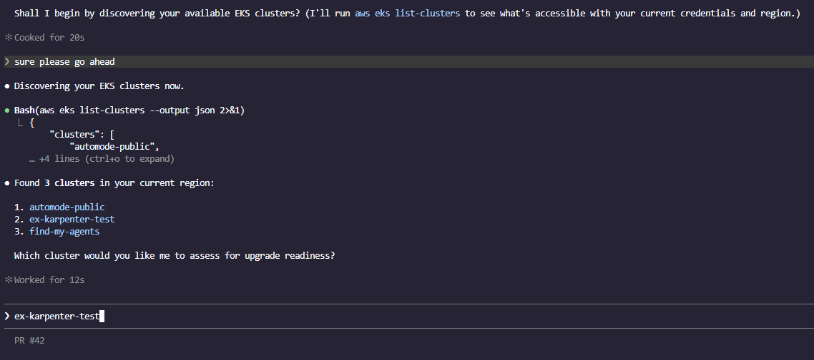
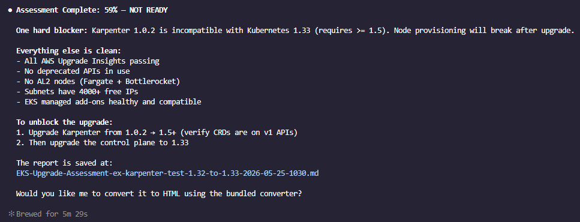
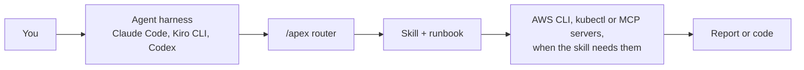

> **Candidate README for comparison; not the repo's README.**

<div align="center">


# APEX Skills

**Agent skills that give your coding agent AWS platform-engineering know-how for Amazon EKS and Amazon ECS.**

[](https://aws-samples.github.io/sample-apex-skills/)
[](https://registry.npmjs.org/apex-skills)
[](../../LICENSE)
[](https://github.com/aws-samples/sample-apex-skills/actions/workflows/docs-sync.yml)

[Docs](https://aws-samples.github.io/sample-apex-skills/) · [Skill catalog](https://aws-samples.github.io/sample-apex-skills/docs/skills/) · [Getting started](https://aws-samples.github.io/sample-apex-skills/docs/getting-started) · [Contributing](../../CONTRIBUTING.md)

</div>

## What APEX is

- **Skills**: what the agent knows. 28 skills ([Agent Skills standard](https://agentskills.io/)) that design, build, review, upgrade and secure EKS and ECS estates.
- **The `/apex` router**: one entry point. Type `/apex` with your request and it picks the right skill and, when there is one, that skill's runbook.
- **DevOps Agent ports**: 6 skills repackaged for [AWS DevOps Agent](https://docs.aws.amazon.com/devopsagent/latest/userguide/).

Built by AWS Solutions Architects, TAMs, and ProServe. 5 skills are vendored from upstream projects; see [Provenance](#provenance).

<!-- INSTALL_SNIPPET_START -->
## Quick start

You need [Node.js 18+](https://nodejs.org/) and [git](https://git-scm.com/).

```bash
npx apex-skills@1.3.0
```

For v2 and its `/apex` router, use the Manual Install (from `main`) in [Getting started](https://aws-samples.github.io/sample-apex-skills/docs/getting-started#manual-install).

The installer detects Claude Code and Kiro CLI, clones the repo to `~/.apex-skills/` and links the skills into place. Then ask your agent:

> /apex is my cluster ready to upgrade to 1.32?

Codex, other harnesses and manual installs: [Getting started](https://aws-samples.github.io/sample-apex-skills/docs/getting-started).
<!-- INSTALL_SNIPPET_END -->

## See it work

The [EKS Upgrade Readiness Check](../../examples/eks-upgrades/in-place-karpenter-check/) example, run in Claude Code:

| The agent finds your clusters | The scored result |
|---|---|
|  |  |

## How it fits



<!-- SKILLS_REFERENCE_START -->
## Skill catalog

28 skills: 13 EKS, 9 ECS, 6 general. Vendored skills are marked †.

### EKS

| Skill | What it does |
|---|---|
| [eks-best-practices](https://aws-samples.github.io/sample-apex-skills/docs/skills/eks/eks-best-practices/) | Advisory guidance on EKS architecture and configuration |
| [eks-build](https://aws-samples.github.io/sample-apex-skills/docs/skills/eks/eks-build/) | Generates apply-ready Terraform for EKS, with optional ArgoCD GitOps |
| [eks-cost-intelligence](https://aws-samples.github.io/sample-apex-skills/docs/skills/eks/eks-cost-intelligence/) | Scores a live cluster's cost efficiency with dollar-quantified findings |
| [eks-design](https://aws-samples.github.io/sample-apex-skills/docs/skills/eks/eks-design/) | Design documents with diagrams and ADRs |
| [eks-genai](https://aws-samples.github.io/sample-apex-skills/docs/skills/eks/eks-genai/) | Building, training and serving GenAI and LLM workloads on EKS |
| [eks-ingress-migration](https://aws-samples.github.io/sample-apex-skills/docs/skills/eks/eks-ingress-migration/) | Plans a move off NGINX Ingress to Gateway API, ALB or AWS Transform |
| [eks-mcp-server](https://aws-samples.github.io/sample-apex-skills/docs/skills/eks/eks-mcp-server/) | Sets up and troubleshoots the EKS MCP Server connection |
| [eks-operation-review](https://aws-samples.github.io/sample-apex-skills/docs/skills/eks/eks-operation-review/) † | Operational excellence review of a live cluster |
| [eks-platform-engineering](https://aws-samples.github.io/sample-apex-skills/docs/skills/eks/eks-platform-engineering/) | Internal developer platforms on EKS |
| [eks-recon](https://aws-samples.github.io/sample-apex-skills/docs/skills/eks/eks-recon/) | Reports the raw facts of a cluster and its environment |
| [eks-security](https://aws-samples.github.io/sample-apex-skills/docs/skills/eks/eks-security/) | Security hardening and compliance guidance for EKS |
| [eks-upgrade-check](https://aws-samples.github.io/sample-apex-skills/docs/skills/eks/eks-upgrade-check/) † | Scores a cluster's upgrade readiness across 8 areas |
| [eks-well-architected-review](https://aws-samples.github.io/sample-apex-skills/docs/skills/eks/eks-well-architected-review/) | Unofficial Well-Architected Framework review of an EKS cluster (Linux nodes) |

### ECS

| Skill | What it does |
|---|---|
| [ecs-architect](https://aws-samples.github.io/sample-apex-skills/docs/skills/ecs/ecs-architect/) | Picks and architects the ECS deployment model for a new workload |
| [ecs-build](https://aws-samples.github.io/sample-apex-skills/docs/skills/ecs/ecs-build/) | Generates apply-ready Terraform for ECS clusters and services |
| [ecs-devops](https://aws-samples.github.io/sample-apex-skills/docs/skills/ecs/ecs-devops/) | Deployments, releases and CI/CD to ECS |
| [ecs-genai](https://aws-samples.github.io/sample-apex-skills/docs/skills/ecs/ecs-genai/) | GPU, ML and GenAI workloads on ECS |
| [ecs-modernize](https://aws-samples.github.io/sample-apex-skills/docs/skills/ecs/ecs-modernize/) | Assesses an app for replatform or rearchitect and runs the migration |
| [ecs-observability](https://aws-samples.github.io/sample-apex-skills/docs/skills/ecs/ecs-observability/) | Logs, metrics and traces architecture for ECS |
| [ecs-operation-review](https://aws-samples.github.io/sample-apex-skills/docs/skills/ecs/ecs-operation-review/) | Operational excellence review of a live ECS estate |
| [ecs-recon](https://aws-samples.github.io/sample-apex-skills/docs/skills/ecs/ecs-recon/) | Discovers an ECS environment |
| [ecs-security](https://aws-samples.github.io/sample-apex-skills/docs/skills/ecs/ecs-security/) | Security and compliance guidance for ECS |

### General

| Skill | What it does |
|---|---|
| [apex](https://aws-samples.github.io/sample-apex-skills/docs/skills/general/apex/) | The `/apex` router for EKS and ECS work |
| [dotnet-aws-ecs](https://aws-samples.github.io/sample-apex-skills/docs/skills/general/dotnet-aws-ecs/) † | Generates CloudFormation or CDK and a guide to deploy .NET to ECS Fargate |
| [graviton-migration](https://aws-samples.github.io/sample-apex-skills/docs/skills/general/graviton-migration/) | Migrates a workload from x86 to AWS Graviton |
| [skill-creator](https://aws-samples.github.io/sample-apex-skills/docs/skills/general/skill-creator/) † | Creates, improves and evaluates skills |
| [terraform-skill](https://aws-samples.github.io/sample-apex-skills/docs/skills/general/terraform-skill/) † | Writing, reviewing and debugging Terraform and OpenTofu |
| [update-docs](https://aws-samples.github.io/sample-apex-skills/docs/skills/general/update-docs/) | Audits and updates this repo's documentation surfaces |
<!-- SKILLS_REFERENCE_END -->

## DevOps Agent

6 Day 2 skills (eks-cost-intelligence, eks-ingress-migration, eks-operation-review, eks-recon, eks-security, eks-upgrade-check) are ported for managed autonomous runs: see [devops-agent/](../../devops-agent/README.md).

<!-- EXAMPLES_REFERENCE_START -->
## Examples

| Example | What you do |
|---|---|
| [Liberty to ECS Modernization](../../examples/ecs-modernize/liberty-to-ecs/) | Assess a Java 8 / WebSphere Liberty app with planted blockers, run both migration paths on ECS, and watch the Fit_Score rise |
| [EKS Upgrade Readiness Check](../../examples/eks-upgrades/in-place-karpenter-check/) | Deploy an EKS 1.32 cluster with planted upgrade issues and get a scored NOT READY report |
<!-- EXAMPLES_REFERENCE_END -->

<!-- VENDORED_START -->
## Provenance

| Skill | Upstream | License |
|---|---|---|
| skill-creator | [anthropics/skills](https://github.com/anthropics/skills) | Apache 2.0 |
| terraform-skill | [antonbabenko/terraform-skill](https://github.com/antonbabenko/terraform-skill) | Apache 2.0 |
| dotnet-aws-ecs | [adisimon217/sample-appmod-skills](https://github.com/adisimon217/sample-appmod-skills) | MIT |
| eks-operation-review | [aws-samples/sample-eks-operation-review-skill](https://github.com/aws-samples/sample-eks-operation-review-skill) | MIT-0 |
| eks-upgrade-check | [aws-samples/sample-eks-upgrade-skill](https://github.com/aws-samples/sample-eks-upgrade-skill) | MIT-0 |

Details: [THIRD_PARTY_NOTICES.md](../../THIRD_PARTY_NOTICES.md).
<!-- VENDORED_END -->

## Contributing

See [CONTRIBUTING.md](../../CONTRIBUTING.md) for adding skills, runbooks and examples. Security issues: [CONTRIBUTING.md, Security Issue Notifications](../../CONTRIBUTING.md#security-issue-notifications).

## Disclaimer

Sample code for **educational and demonstration purposes only**. It is not intended for direct production use without proper review, testing, and validation. Test generated infrastructure (Terraform, Helm charts, kubectl commands) in non-production environments first. Use at your own risk.

## License

MIT-0. See [LICENSE](../../LICENSE).
