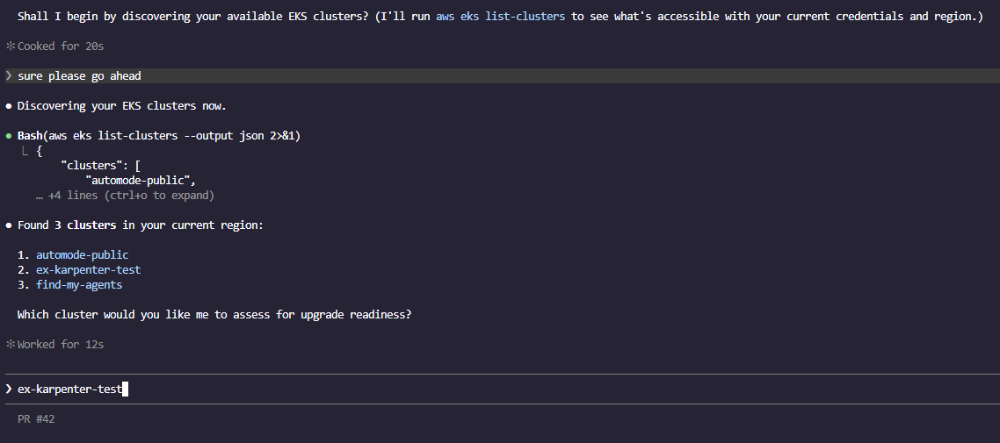
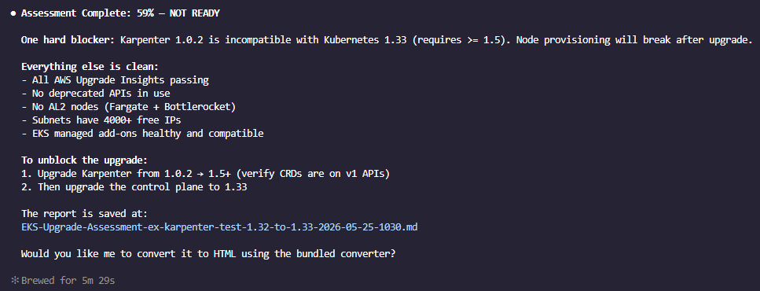
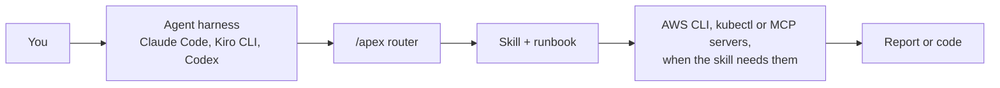

<div align="center">


# APEX Skills

**Platform engineering with agents: curated AWS skills for Amazon EKS and Amazon ECS, delivered through your AI coding agent.**

[](https://aws-samples.github.io/sample-apex-skills/)
[](https://www.npmjs.com/package/apex-skills)
[](../../LICENSE)
[](https://github.com/aws-samples/sample-apex-skills/actions/workflows/docs-sync.yml)

[Docs](https://aws-samples.github.io/sample-apex-skills/) · [Find a skill](https://aws-samples.github.io/sample-apex-skills/docs/skills/) · [Getting started](https://aws-samples.github.io/sample-apex-skills/docs/getting-started/) · [Contributing](../../CONTRIBUTING.md)

</div>

## What APEX is

- **Skills**: what your agent knows. 28 skills, written to the [Agent Skills standard](https://agentskills.io/), that design, build, review, upgrade and secure Amazon EKS and Amazon ECS estates.
- **The `/apex` router** (installed from `main`, below): one entry point. Type `/apex` with your request and it picks the right skill and, when there is one, that skill's runbook.
- **DevOps Agent ports**: 6 Day 2 skills repackaged for [AWS DevOps Agent](https://docs.aws.amazon.com/devopsagent/latest/userguide/).

Domain knowledge by AWS Solutions Architects, TAMs and ProServe. 5 skills are vendored from upstream projects; see [Provenance](#provenance).

## Quick start

You need [Node.js 18+](https://nodejs.org/) and [git](https://git-scm.com/), on macOS or Linux (on Windows, use WSL).

```bash
npx apex-skills@1.3.0
```

The installer detects Claude Code and Kiro CLI, clones the repo to `~/.apex-skills/` and links the skills into place. It installs the latest published release of the skills.

Ask your agent in plain words and the matching skill loads:

> Is my EKS cluster ready to upgrade to 1.32?

In Claude Code this install also adds `/apex:*` commands, such as `/apex:eks-upgrade-check`; Kiro CLI gets the workflows, without the `eks` hub, as manual steering files in `~/.kiro/steering/`.

Flags, updates and uninstall: [installer README](../../misc/installer/README.md).

### The `/apex` router

To use the router in Claude Code or Kiro CLI, install from `main` (this also moves an existing install to `main`, which has no `/apex:*` commands or Kiro steering files):

```bash
npx apex-skills@1.3.0 --branch main
```

Then type your request after the router:

> /apex is my cluster ready to upgrade to 1.32?

For Codex, which the installer does not set up, copy the skills by hand:

```bash
git clone https://github.com/aws-samples/sample-apex-skills.git
mkdir -p ~/.agents/skills && cp -r sample-apex-skills/skills/* ~/.agents/skills/
```

In Codex the router is `$apex`. `/apex` in Kiro CLI was tested on 2.35.1; 1.27.0 rejected it. Other harnesses, and the optional agent guardrails in [rules/AGENTS.md](../../rules/AGENTS.md): [Getting started](https://aws-samples.github.io/sample-apex-skills/docs/getting-started/).

## See it work

The [EKS Upgrade Readiness Check](../../examples/eks-upgrades/in-place-karpenter-check/) example, run in Claude Code:

| The agent finds your clusters | The scored result |
|---|---|
|  |  |

## How it fits



<!-- SKILLS_REFERENCE_START -->
## Skills Reference

> _This table is auto-generated by [`misc/update-skills-references.sh`](../../misc/update-skills-references.sh). Do not edit manually._

### EKS Skills

<table>
<tr><td><a href="https://aws-samples.github.io/sample-apex-skills/docs/skills/eks/eks-best-practices/"><b>eks-best-practices</b></a></td><td><a href="https://aws-samples.github.io/sample-apex-skills/docs/skills/eks/eks-build/"><b>eks-build</b></a></td><td><a href="https://aws-samples.github.io/sample-apex-skills/docs/skills/eks/eks-cost-intelligence/"><b>eks-cost-intelligence</b></a></td><td><a href="https://aws-samples.github.io/sample-apex-skills/docs/skills/eks/eks-design/"><b>eks-design</b></a></td></tr>
<tr><td><a href="https://aws-samples.github.io/sample-apex-skills/docs/skills/eks/eks-genai/"><b>eks-genai</b></a></td><td><a href="https://aws-samples.github.io/sample-apex-skills/docs/skills/eks/eks-ingress-migration/"><b>eks-ingress-migration</b></a></td><td><a href="https://aws-samples.github.io/sample-apex-skills/docs/skills/eks/eks-mcp-server/"><b>eks-mcp-server</b></a></td><td><a href="https://aws-samples.github.io/sample-apex-skills/docs/skills/eks/eks-operation-review/"><b>eks-operation-review</b></a></td></tr>
<tr><td><a href="https://aws-samples.github.io/sample-apex-skills/docs/skills/eks/eks-platform-engineering/"><b>eks-platform-engineering</b></a></td><td><a href="https://aws-samples.github.io/sample-apex-skills/docs/skills/eks/eks-recon/"><b>eks-recon</b></a></td><td><a href="https://aws-samples.github.io/sample-apex-skills/docs/skills/eks/eks-security/"><b>eks-security</b></a></td><td><a href="https://aws-samples.github.io/sample-apex-skills/docs/skills/eks/eks-upgrade-check/"><b>eks-upgrade-check</b></a></td></tr>
<tr><td><a href="https://aws-samples.github.io/sample-apex-skills/docs/skills/eks/eks-well-architected-review/"><b>eks-well-architected-review</b></a></td><td></td><td></td><td></td></tr>
</table>

### ECS Skills

<table>
<tr><td><a href="https://aws-samples.github.io/sample-apex-skills/docs/skills/ecs/ecs-architect/"><b>ecs-architect</b></a></td><td><a href="https://aws-samples.github.io/sample-apex-skills/docs/skills/ecs/ecs-build/"><b>ecs-build</b></a></td><td><a href="https://aws-samples.github.io/sample-apex-skills/docs/skills/ecs/ecs-devops/"><b>ecs-devops</b></a></td></tr>
<tr><td><a href="https://aws-samples.github.io/sample-apex-skills/docs/skills/ecs/ecs-genai/"><b>ecs-genai</b></a></td><td><a href="https://aws-samples.github.io/sample-apex-skills/docs/skills/ecs/ecs-modernize/"><b>ecs-modernize</b></a></td><td><a href="https://aws-samples.github.io/sample-apex-skills/docs/skills/ecs/ecs-observability/"><b>ecs-observability</b></a></td></tr>
<tr><td><a href="https://aws-samples.github.io/sample-apex-skills/docs/skills/ecs/ecs-operation-review/"><b>ecs-operation-review</b></a></td><td><a href="https://aws-samples.github.io/sample-apex-skills/docs/skills/ecs/ecs-recon/"><b>ecs-recon</b></a></td><td><a href="https://aws-samples.github.io/sample-apex-skills/docs/skills/ecs/ecs-security/"><b>ecs-security</b></a></td></tr>
</table>

### General

<table>
<tr><td><a href="https://aws-samples.github.io/sample-apex-skills/docs/skills/general/apex/"><b>apex</b></a></td><td><a href="https://aws-samples.github.io/sample-apex-skills/docs/skills/general/dotnet-aws-ecs/"><b>dotnet-aws-ecs</b></a></td><td><a href="https://aws-samples.github.io/sample-apex-skills/docs/skills/general/graviton-migration/"><b>graviton-migration</b></a></td></tr>
<tr><td><a href="https://aws-samples.github.io/sample-apex-skills/docs/skills/general/skill-creator/"><b>skill-creator</b></a></td><td><a href="https://aws-samples.github.io/sample-apex-skills/docs/skills/general/terraform-skill/"><b>terraform-skill</b></a></td><td><a href="https://aws-samples.github.io/sample-apex-skills/docs/skills/general/update-docs/"><b>update-docs</b></a></td></tr>
</table>
<!-- SKILLS_REFERENCE_END -->

<!-- EXAMPLES_REFERENCE_START -->
## Examples

> _This table is auto-generated by [`misc/update-examples-references.sh`](../../misc/update-examples-references.sh). Do not edit manually._

| Example | Description | Workflow |
|---------|-------------|----------|
| **[Liberty to ECS Modernization](../../examples/ecs-modernize/liberty-to-ecs/)** | Assess a Java 8 / WebSphere Liberty application carrying planted modernization blockers, score it with the APEX ecs-modernize skill, then execute both migration paths on ECS — Replatform as-is onto ECS on EC2 and Rearchitect onto Fargate — and re-assess to see the Fit_Score rise from the Replatform band into the Rearchitect band. | -- |
| **[EKS Upgrade Readiness Check](../../examples/eks-upgrades/in-place-karpenter-check/)** | Deploy an EKS 1.32 cluster with Karpenter v1.0.2 and planted upgrade issues, then run the APEX EKS upgrade-check skill to produce a scored readiness report showing NOT READY status. | [eks-upgrade-check](../../skills/apex/runbooks/eks-upgrade-check/eks-upgrade-check.md) |
<!-- EXAMPLES_REFERENCE_END -->

## DevOps Agent

6 Day 2 skills (eks-cost-intelligence, eks-ingress-migration, eks-operation-review, eks-recon, eks-security, eks-upgrade-check) are ported for managed autonomous runs in AWS DevOps Agent: see [devops-agent/](../../devops-agent/README.md).

## Provenance

5 skills are vendored from upstream and synced by `misc/sync-*.sh`; do not edit them here. Three carry small sync-time edits, listed in each skill's UPSTREAM.md.

| Skill | Upstream | License |
|---|---|---|
| skill-creator | [anthropics/skills](https://github.com/anthropics/skills) | Apache 2.0 |
| terraform-skill | [antonbabenko/terraform-skill](https://github.com/antonbabenko/terraform-skill) | Apache 2.0 |
| dotnet-aws-ecs | [adisimon217/sample-appmod-skills](https://github.com/adisimon217/sample-appmod-skills) | MIT |
| eks-operation-review | [aws-samples/sample-eks-operation-review-skill](https://github.com/aws-samples/sample-eks-operation-review-skill) | MIT-0 |
| eks-upgrade-check | [aws-samples/sample-eks-upgrade-skill](https://github.com/aws-samples/sample-eks-upgrade-skill) | MIT-0 |

Details: [THIRD_PARTY_NOTICES.md](../../THIRD_PARTY_NOTICES.md) and the UPSTREAM.md of [dotnet-aws-ecs](../../skills/dotnet-aws-ecs/UPSTREAM.md), [eks-operation-review](../../skills/eks-operation-review/UPSTREAM.md) and [eks-upgrade-check](../../skills/eks-upgrade-check/UPSTREAM.md).

## Contributing

See [CONTRIBUTING.md](../../CONTRIBUTING.md) for adding skills, runbooks and examples. Security issues: [CONTRIBUTING.md, Security Issue Notifications](../../CONTRIBUTING.md#security-issue-notifications).

## Disclaimer

Sample code for **educational and demonstration purposes only**. It is not intended for direct production use without proper review, testing, and validation. Test generated infrastructure (Terraform, Helm charts, kubectl commands) in non-production environments first. Use at your own risk: the authors are not responsible for any issues, damages, or losses that may result from using this code in production.

## License

MIT-0. See [LICENSE](../../LICENSE).
