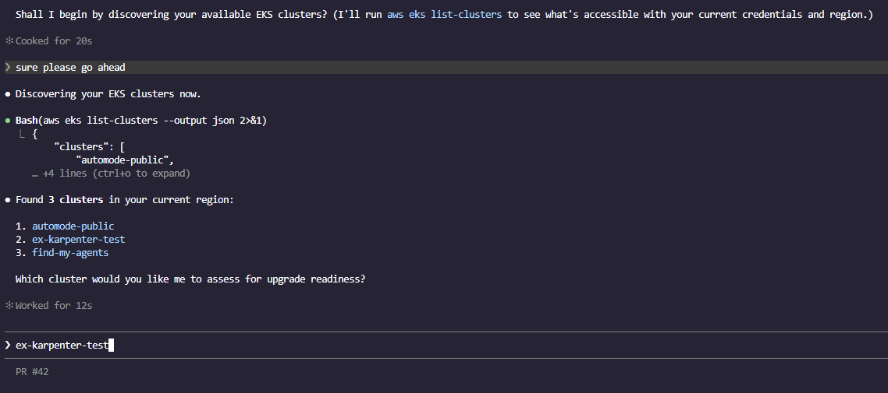
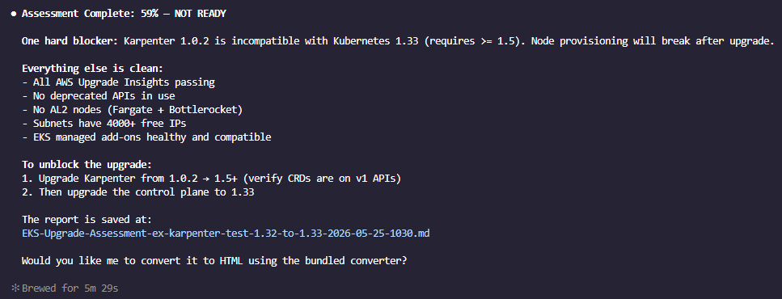
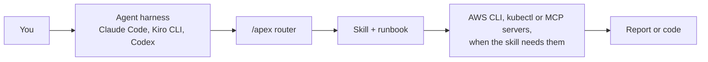

<div align="center">


# APEX Skills

**Platform engineering with agents: curated AWS skills for Amazon EKS and Amazon ECS, delivered through your AI coding agent.**

[](https://aws-samples.github.io/sample-apex-skills/)
[](https://www.npmjs.com/package/apex-skills)
[](../../LICENSE)
[](https://github.com/aws-samples/sample-apex-skills/actions/workflows/docs-sync.yml)

[Docs](https://aws-samples.github.io/sample-apex-skills/) · [Find a skill](https://aws-samples.github.io/sample-apex-skills/docs/skills/) · [Getting started](https://aws-samples.github.io/sample-apex-skills/docs/getting-started/) · [Contributing](../../CONTRIBUTING.md)

</div>

## What APEX is

- **Skills**: what your agent knows. 28 skills, written to the [Agent Skills standard](https://agentskills.io/), that design, build, review, upgrade and secure Amazon EKS and Amazon ECS estates.
- **The `/apex` router** (installed from `main`, below): one entry point. Type `/apex` with your request and it picks the right skill and, when there is one, that skill's runbook.
- **DevOps Agent ports**: 6 Day 2 skills repackaged for [AWS DevOps Agent](https://docs.aws.amazon.com/devopsagent/latest/userguide/).

Domain knowledge by AWS Solutions Architects, TAMs and ProServe. 5 skills are vendored from upstream projects; see [Provenance](#provenance).

## Quick start

You need [Node.js 18+](https://nodejs.org/) and [git](https://git-scm.com/), on macOS or Linux (on Windows, use WSL).

```bash
npx apex-skills@1.3.0
```

The installer detects Claude Code and Kiro CLI, clones the repo to `~/.apex-skills/` and links the skills into place. It installs the latest published release of the skills.

Ask your agent in plain words and the matching skill loads:

> Is my EKS cluster ready to upgrade to 1.32?

In Claude Code this install also adds `/apex:*` commands, such as `/apex:eks-upgrade-check`; Kiro CLI gets the workflows, without the `eks` hub, as manual steering files in `~/.kiro/steering/`.

Flags, updates and uninstall: [installer README](../../misc/installer/README.md).

### The `/apex` router

To use the router in Claude Code or Kiro CLI, install from `main` (this also moves an existing install to `main`, which has no `/apex:*` commands or Kiro steering files):

```bash
npx apex-skills@1.3.0 --branch main
```

Then type your request after the router:

> /apex is my cluster ready to upgrade to 1.32?

For Codex, which the installer does not set up, copy the skills by hand:

```bash
git clone https://github.com/aws-samples/sample-apex-skills.git
mkdir -p ~/.agents/skills && cp -r sample-apex-skills/skills/* ~/.agents/skills/
```

In Codex the router is `$apex`. `/apex` in Kiro CLI was tested on 2.35.1; 1.27.0 rejected it. Other harnesses, and the optional agent guardrails in [rules/AGENTS.md](../../rules/AGENTS.md): [Getting started](https://aws-samples.github.io/sample-apex-skills/docs/getting-started/).

## See it work

The [EKS Upgrade Readiness Check](../../examples/eks-upgrades/in-place-karpenter-check/) example, run in Claude Code:

| The agent finds your clusters | The scored result |
|---|---|
|  |  |

## How it fits



## Pick a skill by what you are doing

> (e) preview: group is the only new per-skill field; the text comes from each SKILL.md description, so there is nothing extra to maintain.

Not sure? Use [`/apex`](https://aws-samples.github.io/sample-apex-skills/docs/skills/general/apex/) and it picks for you.

### Knowledge Skills

Guidance your agent draws on when you ask and decide.

| Skill | What it does (first sentence of its SKILL.md description) |
|---|---|
| [eks-best-practices](https://aws-samples.github.io/sample-apex-skills/docs/skills/eks/eks-best-practices/) | Advisory guidance for Amazon EKS architecture and configuration — compute strategy, networking, security, reliability, cost, autoscaling, observability, multi-tenancy, upgrade planning, on-prem/hybrid (EKS Hybrid Nodes, EKS Anywhere, Outposts), and surge readiness for planned traffic peaks. |
| [eks-genai](https://aws-samples.github.io/sample-apex-skills/docs/skills/eks/eks-genai/) | Use whenever someone is building, training, fine-tuning, or serving a generative AI / LLM workload on Amazon EKS — phrased as "GPU vs Trainium/Inferentia", "vLLM on EKS", "Ray Serve / KubeRay", "distributed training on EKS", "FSx for Lustre for ML", "Karpenter for GPU", "EFA / NCCL multi-node", "DCGM / Neuron Monitor", "LiteLLM / AI gateway", "RAG on EKS", "agentic AI on EKS", or "self-host Llama / Mistral / Qwen". |
| [eks-platform-engineering](https://aws-samples.github.io/sample-apex-skills/docs/skills/eks/eks-platform-engineering/) | Use whenever someone is designing or building an Internal Developer Platform (IDP) or doing platform engineering on Amazon EKS — phrased as "build a developer platform", "self-service for developers", "golden paths", "IDP", or "set up Backstage / ArgoCD / Kargo". |
| [ecs-genai](https://aws-samples.github.io/sample-apex-skills/docs/skills/ecs/ecs-genai/) | Use whenever someone runs a GPU / ML / GenAI / LLM workload on Amazon ECS: GPU on ECS, ECS GPU-optimized AMI, g4dn/g5/g6/p4/p5 on ECS, which ECS launch type for GPU, Inferentia/Trainium/Neuron on ECS, distributed training, model inference or vLLM/Triton/TGI/Ray on ECS, Capacity Blocks, GPU sharing, ASG per GPU type. |

### Day 0 Design

Choose an architecture before you build.

| Skill | What it does (first sentence of its SKILL.md description) |
|---|---|
| [eks-design](https://aws-samples.github.io/sample-apex-skills/docs/skills/eks/eks-design/) | Use when designing EKS architecture. |
| [ecs-architect](https://aws-samples.github.io/sample-apex-skills/docs/skills/ecs/ecs-architect/) | Use when choosing and architecting an Amazon ECS deployment model for a NEW workload — Fargate vs ECS on EC2 vs Managed Instances vs Express Mode vs ECS Anywhere/External — plus capacity-provider strategy, task sizing, awsvpc/ENI density, networking, service parameters, and launch-type or topology migration (EC2 launch type to capacity providers/Managed Instances; Service Discovery to Service Connect). |
| [ecs-observability](https://aws-samples.github.io/sample-apex-skills/docs/skills/ecs/ecs-observability/) | Advise on Amazon ECS observability architecture — select the logs/metrics/traces stack (CloudWatch, Container Insights, X-Ray, ADOT/OpenTelemetry, Managed Prometheus/Grafana, FireLens to third-party) by compliance needs, existing tooling, scale, budget, and launch types (EC2, Fargate, Managed Instances, ECS Anywhere). |

### Day 1 Build

Generate the infrastructure code and the release path.

| Skill | What it does (first sentence of its SKILL.md description) |
|---|---|
| [eks-build](https://aws-samples.github.io/sample-apex-skills/docs/skills/eks/eks-build/) | Use when building EKS clusters. |
| [ecs-build](https://aws-samples.github.io/sample-apex-skills/docs/skills/ecs/ecs-build/) | Use when building Amazon ECS infrastructure with Terraform, generating apply-ready code for ECS clusters, services, and task definitions across three capacity models — Fargate (FARGATE_SPOT as capacity provider), EC2 Auto Scaling group providers, and ECS Managed Instances. |
| [ecs-devops](https://aws-samples.github.io/sample-apex-skills/docs/skills/ecs/ecs-devops/) | Use when someone is deploying, releasing, or shipping software to Amazon ECS — phrased as "blue/green deployment on ECS", "canary deployment for my ECS service", "set up CI/CD for ECS", "GitHub Actions deploy to Fargate", "my ECS deployment is stuck", "ECS deployment circuit breaker", "ECS task sets", or "migrate off CodeDeploy blue/green". |
| [dotnet-aws-ecs](https://aws-samples.github.io/sample-apex-skills/docs/skills/general/dotnet-aws-ecs/) | Generates IaC (CloudFormation or CDK) and a deployment guide to deploy a .NET workload to Amazon ECS Fargate on Linux containers with an Application Load Balancer. |
| [terraform-skill](https://aws-samples.github.io/sample-apex-skills/docs/skills/general/terraform-skill/) | Use when writing, reviewing, or debugging Terraform/OpenTofu modules, tests, CI, scans, or state ops - diagnoses failure mode (identity churn, secrets, blast radius, CI drift, state corruption) with version-aware guards. |

### Day 2 Operate: assess what is running

Discover, score and review a live cluster or estate.

| Skill | What it does (first sentence of its SKILL.md description) |
|---|---|
| [eks-recon](https://aws-samples.github.io/sample-apex-skills/docs/skills/eks/eks-recon/) | EKS cluster reconnaissance and environment discovery — reports the raw FACTS of a cluster and its environment. |
| [ecs-recon](https://aws-samples.github.io/sample-apex-skills/docs/skills/ecs/ecs-recon/) | ECS environment reconnaissance and discovery. |
| [eks-operation-review](https://aws-samples.github.io/sample-apex-skills/docs/skills/eks/eks-operation-review/) | Run a structured EKS operational excellence assessment against a live cluster. |
| [ecs-operation-review](https://aws-samples.github.io/sample-apex-skills/docs/skills/ecs/ecs-operation-review/) | Run a structured Amazon ECS operational-excellence assessment against a live estate (Fargate/EC2/Managed Instances/ECS Anywhere) and score it GREEN/AMBER/RED. |
| [eks-well-architected-review](https://aws-samples.github.io/sample-apex-skills/docs/skills/eks/eks-well-architected-review/) | Deterministic AWS Well-Architected Framework review of an Amazon EKS cluster (Linux nodes only). |
| [eks-cost-intelligence](https://aws-samples.github.io/sample-apex-skills/docs/skills/eks/eks-cost-intelligence/) | Run a live EKS cluster cost efficiency assessment — analyze spending across 6 dimensions (compute efficiency, Spot/Graviton adoption, networking, storage, observability, idle resources), calculate a weighted 0-100 Cost Score, and generate a prioritized report with dollar-quantified findings and ready-to-apply remediation snippets. |

### Day 2 Operate: upgrade and migrate

Move a version, a controller, a CPU architecture or an app.

| Skill | What it does (first sentence of its SKILL.md description) |
|---|---|
| [eks-upgrade-check](https://aws-samples.github.io/sample-apex-skills/docs/skills/eks/eks-upgrade-check/) | Assess EKS cluster upgrade readiness — run automated checks across 8 areas (version, breaking changes, deprecated APIs, add-on compatibility, node readiness, workload risks, AWS Insights, upgrade plan), calculate a 0-100 readiness score with a hard-blocker override, and generate a markdown/HTML report with prioritized remediation. |
| [eks-ingress-migration](https://aws-samples.github.io/sample-apex-skills/docs/skills/eks/eks-ingress-migration/) | Assess a live EKS cluster's NGINX/Ingress estate and plan migration to Gateway API, the AWS Load Balancer Controller (ALB Ingress), or AWS Transform (ATX). |
| [graviton-migration](https://aws-samples.github.io/sample-apex-skills/docs/skills/general/graviton-migration/) | Execute a workload migration from x86 (amd64) to AWS Graviton (arm64) — set up the Arm migration MCP server for code, dependency, and container arm64-readiness scanning, then run the migration — pre-migration scanning, Karpenter arm64 node cutover, and multi-arch CI pipelines. |
| [ecs-modernize](https://aws-samples.github.io/sample-apex-skills/docs/skills/ecs/ecs-modernize/) | Assess an existing app (VMware/EC2) by source code analysis for the replatform vs rearchitect decision, and execute the approved migration onto Amazon ECS. |

### Day 2 Operate: secure

Check exposure, harden and prepare for audits.

| Skill | What it does (first sentence of its SKILL.md description) |
|---|---|
| [eks-security](https://aws-samples.github.io/sample-apex-skills/docs/skills/eks/eks-security/) | Read-only scripted security reviews of a live Amazon EKS cluster (exposed / not exposed / unknown), plus hardening and compliance guidance. |
| [ecs-security](https://aws-samples.github.io/sample-apex-skills/docs/skills/ecs/ecs-security/) | Security and compliance guidance for Amazon ECS — "ECS was unable to assume the role", task role vs execution role, iam:PassRole, confused-deputy aws:SourceArn trust, Fargate vs EC2 shared responsibility, injecting Secrets Manager/SSM secrets (trailing-colon JSON-key gotcha), readonlyRootFilesystem / non-root / drop capabilities, ECS Exec governance, security-group-per-task, VPC endpoint policies, GuardDuty ECS Runtime Monitoring, ECR Inspector scanning, image signing, Fargate FIPS, or PCI/HIPAA/FedRAMP. |

### Set up and extend

Connect tools, write your own skills, keep docs in sync.

| Skill | What it does (first sentence of its SKILL.md description) |
|---|---|
| [apex](https://aws-samples.github.io/sample-apex-skills/docs/skills/general/apex/) | APEX router for Amazon EKS and Amazon ECS work. |
| [eks-mcp-server](https://aws-samples.github.io/sample-apex-skills/docs/skills/eks/eks-mcp-server/) | Install, configure, and troubleshoot the EKS MCP Server connection in your AI assistant (Claude Code, Cursor, Kiro). |
| [skill-creator](https://aws-samples.github.io/sample-apex-skills/docs/skills/general/skill-creator/) | Create new skills, modify and improve existing skills, and measure skill performance. |
| [update-docs](https://aws-samples.github.io/sample-apex-skills/docs/skills/general/update-docs/) | Audit and update every documentation surface in the APEX repo against the current state of skills, steering workflows, README marker tables, and the Docusaurus site under misc/website/. |

<!-- EXAMPLES_REFERENCE_START -->
## Examples

> _This table is auto-generated by [`misc/update-examples-references.sh`](../../misc/update-examples-references.sh). Do not edit manually._

| Example | Description | Workflow |
|---------|-------------|----------|
| **[Liberty to ECS Modernization](../../examples/ecs-modernize/liberty-to-ecs/)** | Assess a Java 8 / WebSphere Liberty application carrying planted modernization blockers, score it with the APEX ecs-modernize skill, then execute both migration paths on ECS — Replatform as-is onto ECS on EC2 and Rearchitect onto Fargate — and re-assess to see the Fit_Score rise from the Replatform band into the Rearchitect band. | -- |
| **[EKS Upgrade Readiness Check](../../examples/eks-upgrades/in-place-karpenter-check/)** | Deploy an EKS 1.32 cluster with Karpenter v1.0.2 and planted upgrade issues, then run the APEX EKS upgrade-check skill to produce a scored readiness report showing NOT READY status. | [eks-upgrade-check](../../skills/apex/runbooks/eks-upgrade-check/eks-upgrade-check.md) |
<!-- EXAMPLES_REFERENCE_END -->

## DevOps Agent

6 Day 2 skills (eks-cost-intelligence, eks-ingress-migration, eks-operation-review, eks-recon, eks-security, eks-upgrade-check) are ported for managed autonomous runs in AWS DevOps Agent: see [devops-agent/](../../devops-agent/README.md).

## Provenance

5 skills are vendored from upstream and synced by `misc/sync-*.sh`; do not edit them here. Three carry small sync-time edits, listed in each skill's UPSTREAM.md.

| Skill | Upstream | License |
|---|---|---|
| skill-creator | [anthropics/skills](https://github.com/anthropics/skills) | Apache 2.0 |
| terraform-skill | [antonbabenko/terraform-skill](https://github.com/antonbabenko/terraform-skill) | Apache 2.0 |
| dotnet-aws-ecs | [adisimon217/sample-appmod-skills](https://github.com/adisimon217/sample-appmod-skills) | MIT |
| eks-operation-review | [aws-samples/sample-eks-operation-review-skill](https://github.com/aws-samples/sample-eks-operation-review-skill) | MIT-0 |
| eks-upgrade-check | [aws-samples/sample-eks-upgrade-skill](https://github.com/aws-samples/sample-eks-upgrade-skill) | MIT-0 |

Details: [THIRD_PARTY_NOTICES.md](../../THIRD_PARTY_NOTICES.md) and the UPSTREAM.md of [dotnet-aws-ecs](../../skills/dotnet-aws-ecs/UPSTREAM.md), [eks-operation-review](../../skills/eks-operation-review/UPSTREAM.md) and [eks-upgrade-check](../../skills/eks-upgrade-check/UPSTREAM.md).

## Contributing

See [CONTRIBUTING.md](../../CONTRIBUTING.md) for adding skills, runbooks and examples. Security issues: [CONTRIBUTING.md, Security Issue Notifications](../../CONTRIBUTING.md#security-issue-notifications).

## Disclaimer

Sample code for **educational and demonstration purposes only**. It is not intended for direct production use without proper review, testing, and validation. Test generated infrastructure (Terraform, Helm charts, kubectl commands) in non-production environments first. Use at your own risk: the authors are not responsible for any issues, damages, or losses that may result from using this code in production.

## License

MIT-0. See [LICENSE](../../LICENSE).
